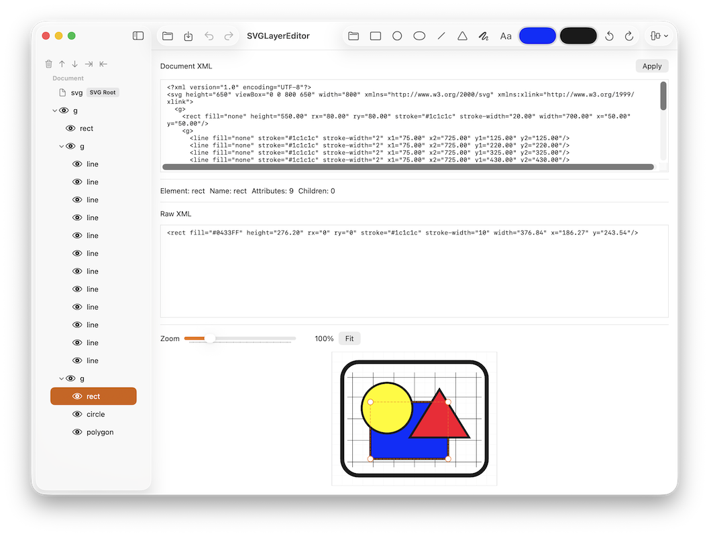

# SVGLayerEditor

SVGLayerEditor is a macOS SwiftUI app for editing SVG layer hierarchies, previewing graphics live, and saving changes without leaving the app. It combines a layer tree with drag-and-drop reordering, a raw XML editor that re-parses on every change, and a live canvas preview with mouse-driven move, resize, rotate, and align tools — so both structural and visual edits stay in sync.

Fully vibe coded / agentic coded using GPT-5.2-Codex.

## Screenshots



## Features

- Open, edit, and save SVG files.
- Document XML editor with live re-parse and error banner.
- Layer tree with selection, drag & drop reorder, indent/outdent, and delete.
- Per-layer visibility toggle (hidden layers not rendered in preview).
- Shapes: `rect`, `circle`, `ellipse`, `line`, `polygon`, `polyline`, `path`, `text`, and group `<g>`.
- Full SVG path syntax (`M L H V C S Q T A Z`, absolute and relative) for preview and editing.
- Preview honours inherited paint from groups, `style` attributes, `<style>` CSS rules (class, id and element selectors), `transform`, `clip-path`, `fill-rule`, dashes and linear/radial gradients.
- Export for Icon Composer: writes an `.icon` bundle with one SVG per layer and an `icon.json`.
- Preserve fill/stroke defaults for new shapes.
- Preview with grid and canvas border, zoom controls, fit-to-view, and selection outlines.
- Mouse drag to move/resize selected elements (paths and basic shapes).
- Rotate selected element in 15-degree steps (rects, ellipses, text and groups get a `rotate()` transform instead of being distorted).
- Align selected element to canvas center or to a reference element.
- Undo/redo through the standard Edit menu (a whole drag or color-panel session is one undo step). In the XML editors `Cmd+Z` undoes typing; elsewhere it undoes document changes.
- Comments and the attribute order of opened files are preserved when saving.
- Open Recent menu (security-scoped bookmarks, so recent files reopen inside the App Sandbox).
- File drop to open SVGs; the app also appears in Finder's "Open With" menu for SVG files.
- Single-window editor: closing the window quits the app (after asking about unsaved changes).
- Unsaved changes indicator; Save / Don't Save / Cancel prompt on close, quit, New, Open and file drop.

## Requirements
- macOS 26.0 or later
- Apple Silicon only

## Installation

### Build from source

Open the Xcode project in `SVGLayerEditor.xcodeproj`.

### Prebuilt DMG

A ready-to-run build is available as `SVGLayerEditor.dmg` (ad-hoc signed, Apple Silicon only). Since it isn't notarized by Apple, macOS blocks it on first launch. Remove the quarantine flag before opening:

```bash
xattr -dr com.apple.quarantine /Applications/SVGLayerEditor.app
```

Alternatively, right-click the app in Finder and choose "Open".

---

## Usage

### UI Overview

- Left: Layer tree with visibility toggles and reorder support.
- Right: Document XML editor, selected element details, and preview.
- Top toolbar: file actions, undo/redo, shape tools, color pickers, rotate, align.

### Document XML Editing

- The "Document XML" editor re-parses the entire SVG on change.
- Parsing errors show as a red banner next to the editor.
- Saving requires a `viewBox` or `width` and `height` on the root `<svg>`. Units (`px`, `pt`, `mm`, …) and percentages are accepted.
- Attributes keep their source order. Attributes of new elements (and attributes added later) follow the layout of Apple's icon assets: `xmlns` first, then identity, geometry and paint. Numbers are written compactly (`550`, not `550.00`).
- Comments are kept and stay attached to the element that follows them.

### Default New Document

New documents use the Icon Composer canvas (size configurable in Settings → Preview):

```
<?xml version="1.0" encoding="UTF-8"?>
<svg xmlns="http://www.w3.org/2000/svg" width="1024" height="1024" viewBox="0 0 1024 1024"/>
```

### Icon Composer

Icon Composer places every layer image at its intrinsic size in points, centered on a 1024 × 1024 pt canvas. An SVG with `width="100" height="100"` therefore becomes a tiny 100 pt square in the icon. Design on a 1024 × 1024 canvas and leave out the background and the rounded-rect mask; Icon Composer supplies both.

**File → Export for Icon Composer…** (`Cmd+Shift+E`) writes a `.icon` bundle you can open in Icon Composer or add to an Xcode project:

- Each top-level `<g>` becomes a group; each of its children becomes a layer.
- Every other top-level element becomes a group with a single layer.
- The front-most (last) element is listed first in `icon.json`, as Icon Composer expects.
- Every layer is written as its own SVG with `width="1024" height="1024"` and the document's viewBox (squared and centered), so layers keep their positions. Shared `<defs>`/`<style>` are copied into each layer, and the parent group's paint and transform are kept.
- Hidden layers are skipped. Icon Composer works best with up to four groups.

Text should be converted to outlines before the final export. Without a `font-family`, CoreSVG (which Icon Composer uses) falls back to Times; new text elements therefore get an explicit `font-family`.

### Layer Operations

- Select any layer to edit its raw XML and attributes.
- Toggle visibility via the eye icon (hidden layers are not rendered).
- Drag & drop to reorder; use indent/outdent for hierarchy changes.

### Shortcuts

- New: `Cmd+N`
- Open: `Cmd+O`
- Save: `Cmd+S`
- Save As: `Cmd+Shift+S`
- Undo: `Cmd+Z`
- Redo: `Cmd+Shift+Z`
- Delete layer: `Cmd+Delete`
- Export for Icon Composer: `Cmd+Shift+E`
- Move Up/Down: `Cmd+Option+Up/Down`
- Indent/Outdent: `Cmd+]` / `Cmd+[`
- Insert from Clipboard: `Cmd+Shift+V`

## Tests

Unit tests live in the `SVGLayerEditorTests` target (XCTest, hosted in the app). Run them with `Cmd+U` in Xcode or:

```bash
xcodebuild -project SVGLayerEditor.xcodeproj -scheme SVGLayerEditor -destination 'platform=macOS,arch=arm64' test
```

## Notes

- Save panels require the App Sandbox user-selected **read/write** entitlement.
- Root SVG attributes (`width`, `height`, `viewBox`) are editable when the root is selected; the root's Raw XML editor applies to the whole document.
- Known limitations: text mixed with child elements (`<text>a<tspan>b</tspan></text>`), processing instructions and the DOCTYPE are not preserved; `<use>`, masks, filters and patterns are kept in the file but not drawn in the interactive preview.

---

## License

This project is licensed under the [PolyForm Noncommercial License 1.0.0](https://polyformproject.org/licenses/noncommercial/1.0.0) — see [LICENSE](LICENSE) for details. Free for noncommercial use; commercial use requires a separate license from the author.
